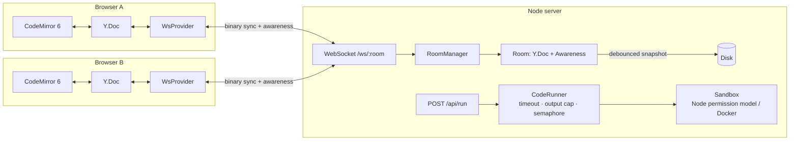

# CodeSync

[](https://github.com/rahulsuryvanshi810/codesync/actions/workflows/ci.yml)


A **real-time collaborative code editor**, like Google Docs for code. Share a link
and several people edit the same file at once. Everyone sees the others' cursors
live, edits made offline merge cleanly after reconnecting, and anyone can run the
code in a sandbox with everyone seeing the same output.

It's built on a **CRDT** (Yjs) with a **WebSocket sync server and client provider
written from scratch**: the binary sync protocol, room lifecycle, presence,
persistence, reconnection and backpressure. It does not use the off-the-shelf
`y-websocket` server.

> Use it for pair programming, mock interviews, or teaching.

## Features

- **Conflict-free concurrent editing.** Any number of users can type at the same position at the same time and every client converges to the same text.
- **Live cursors and selections** in each user's color, with names and a presence list.
- **Offline-first.** Keep typing through a dropped connection. The client reconnects with exponential backoff and sends only the diff it's missing.
- **Shared code execution** for JavaScript and Python. Run state is part of the shared doc, so everyone sees "Alice is running…" and then the same output. There's also a shared stdin box.
- **Persistence.** Rooms are saved to disk (debounced, atomic writes) and survive restarts and deploys.
- **Production behavior:** heartbeats to detect dead connections, per-connection message rate limits, a room size cap, input validation, graceful shutdown that flushes every room, path-traversal-safe static serving, and a Docker image.

## Architecture



### Why a CRDT and not operational transform (OT)?

Google Docs uses **OT**. A central server transforms every operation against the
operations that happened concurrently. That's correct, but the transform functions
are notoriously hard to get right, and the server has to sequence every edit.

A **CRDT** (Conflict-free Replicated Data Type) gives every character a unique ID
and a position relative to its neighbours. Merging two replicas is commutative,
associative and idempotent, so updates can arrive in any order, be applied twice,
or be batched up offline, and every replica still ends up in the same state. The
server's job shrinks to *relaying and persisting* updates. It never resolves
conflicts. That is what makes offline editing and horizontal scaling simpler.

### Sync protocol

Messages are binary: `[varUint type][payload]`. This is the same format as
`y-websocket`, so its clients are compatible.

```
client                                  server
  │ ── SYNC step1 (my state vector) ──────► │
  │ ◄────── SYNC step1 (server state vec) ── │
  │ ◄── SYNC step2 (updates you're missing)  │
  │ ── SYNC step2 (updates you're missing) ► │   ← offline edits upload here
  │                                          │
  │ ── SYNC update (each local edit) ──────► │ ──► relayed to every other client
  │ ── AWARENESS (cursor, name, color) ────► │ ──► relayed, never persisted
```

The state vector exchange means a client that was offline for an hour sends only
the edits the server hasn't seen. It never re-sends the whole document.

### Design decisions

| Problem | Solution |
|---|---|
| Two users join a brand-new room at the same instant | `RoomManager` caches the *promise* of the loading room, so both share one load and one Y.Doc |
| Client's handshake arrives before the room finishes loading from disk | Early WebSocket messages are buffered and replayed once the room is ready |
| User rejoins while the room's final snapshot is still being written | `get()` waits for the pending flush before reloading, so the latest edits aren't lost |
| A save and a shutdown flush write the same room at once | Writes are chained per room and go to a unique temp file, then `rename()` (atomic) |
| Laptop lid closes and the TCP connection half-opens | Ping/pong heartbeat terminates dead sockets, so their cursors disappear for others |
| User disconnects mid-run and "Running…" never clears | Run state carries a timestamp and is considered stale after 15 s |
| One client floods the room with messages | Token-bucket budget per connection (200 msg/s, burst 600); offenders are closed with `1008` |
| Undo shouldn't revert a collaborator's code | `Y.UndoManager` tracks only local-origin transactions |

### Code execution sandbox

Running arbitrary code from the internet is the riskiest part of the system, so it
uses defense in depth:

- **Always on:** 5 s wall-clock timeout (SIGKILL), 64 KB output cap, 100 KB code cap,
  at most 4 concurrent runs with a bounded queue (`503` beyond it), a per-IP limit of
  20 runs/minute, a throwaway temp directory, and a scrubbed environment (server
  secrets never reach user code).
- **JavaScript** runs under **Node's permission model**. It can read only its own
  directory. File writes, `child_process`, worker threads and native addons throw
  `ERR_ACCESS_DENIED`, and a test verifies this.
- **Python** runs in isolated mode (`-I`).
- **`CODESYNC_SANDBOX=docker`** runs every snippet in a fresh container with
  `--network none`, a read-only filesystem, a 128 MB memory limit, 0.5 CPU,
  `--pids-limit 64`, a non-root user and `no-new-privileges`. Use this for public
  deployments.

## Quick start

```bash
git clone https://github.com/rahulsuryvanshi810/codesync.git
cd codesync
npm install
npm run dev            # API on :3001, Vite on :5173 (proxied, one origin)
```

Open http://localhost:5173, create a room, then open the same URL in a second
window (or send it to a friend) and start typing in both.

### Production

```bash
npm run build && npm start        # one Node process serves the client + API + WebSockets on :3001
# or
docker build -t codesync . && docker run -p 3001:3001 -v codesync-data:/data codesync
```

| Env var | Default | Purpose |
|---|---|---|
| `PORT` | `3001` | HTTP/WebSocket port |
| `DATA_DIR` | `./data` | Where room snapshots are stored |
| `STATIC_DIR` | `client/dist` | Built client to serve |
| `CODESYNC_SANDBOX` | `process` | `docker` for container isolation |

## Tests

```bash
npm test
```

There are 23 integration tests. They start a real server on a random port and drive
it with the **same `WsProvider` class the browser uses** (Node 22 has a built-in
`WebSocket`):

- An edit propagates to every client in the room, and rooms are isolated
- **3 users type 20 characters each at the same position simultaneously**, and all replicas end up byte-identical
- **Offline edits:** A disconnects and edits, B keeps editing, A reconnects, and both converge
- Presence appears, and cursors are removed when a user leaves
- Late joiners get the full doc and current presence
- Persistence across a server restart, and across room unload and reload
- Invalid room IDs rejected at the handshake, room cap (`1013`), malformed messages (`1003`)
- Runner: stdout/stderr/exit code, stdin, infinite loop killed, output cap, **sandbox blocks fs writes and process spawning**, env not leaked, concurrency limit
- HTTP: validation, per-IP rate limit, 404s

## Project structure

```
server/src/
  index.js        HTTP routes, WebSocket upgrade, heartbeat, static serving
  rooms.js        Room (Y.Doc + awareness + connections), RoomManager (lifecycle)
  protocol.js     binary message encoding
  persistence.js  debounced, serialized, atomic snapshot writes
  runner.js       sandboxed code execution with a concurrency semaphore
client/src/
  lib/provider.js WebSocket provider: handshake, reconnect with backoff, awareness
  lib/useCollab.js React hooks for the doc, connection status, presence, Y.Map values
  components/     Editor (CodeMirror 6 + y-codemirror), OutputPanel, Presence
  pages/          Home, Room
```

## Scaling further

A single Node process comfortably handles many rooms because each room is
independent. To scale horizontally:

1. **Sticky routing by room ID** at the load balancer, so all users of a room hit the same node. This is the simplest option.
2. Or **Redis pub/sub fan-out**. Each node subscribes to `room:<id>` and publishes the updates it receives. Because CRDT updates are idempotent and commutative, duplicate or reordered delivery across nodes is harmless.
3. Move snapshots from local disk to Postgres or S3. `FilePersistence` is a three-method interface.

## License

MIT © Rahul Suryavanshi
